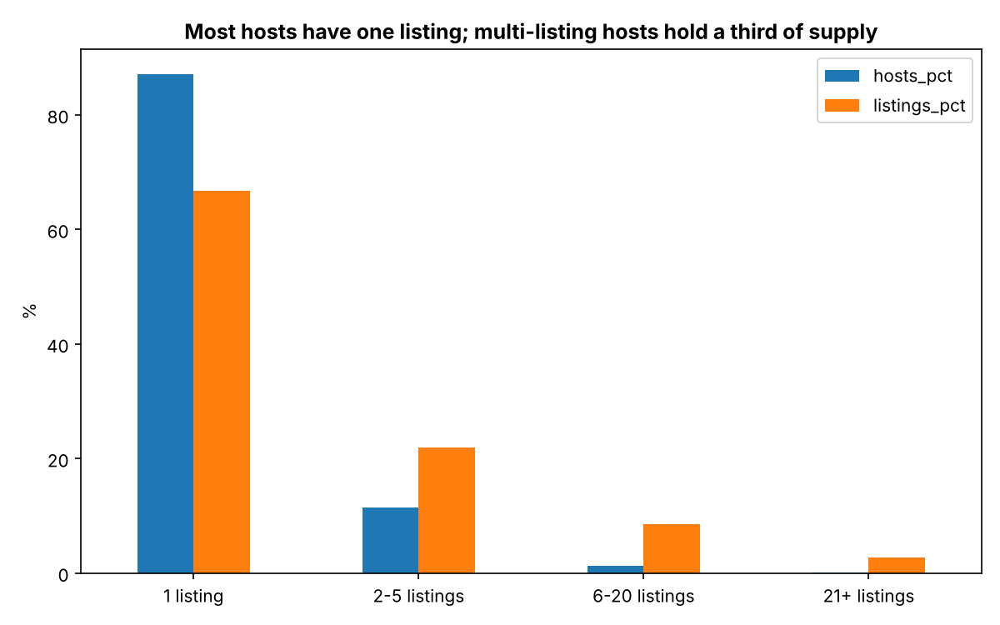
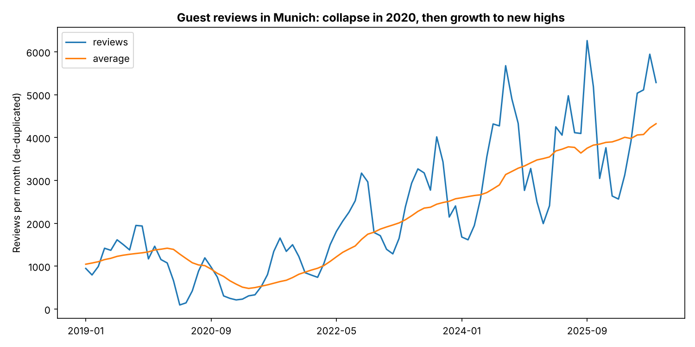
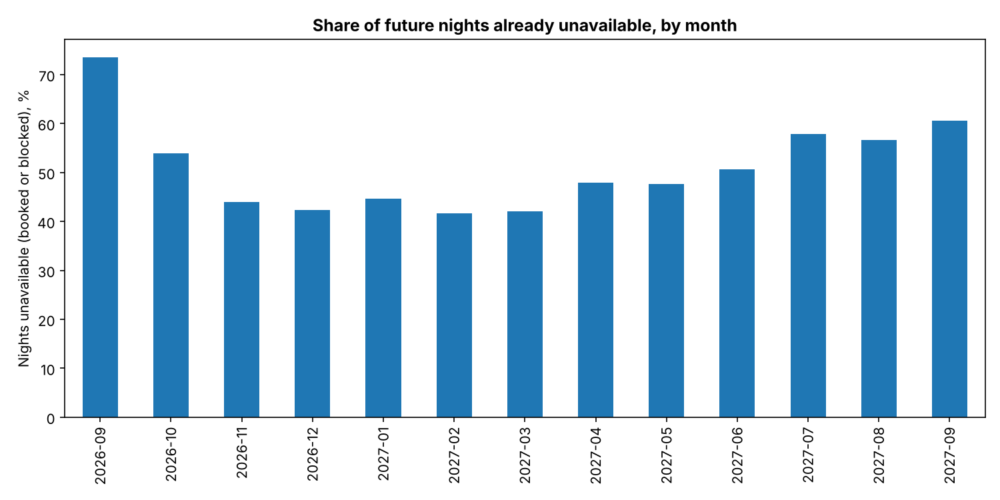
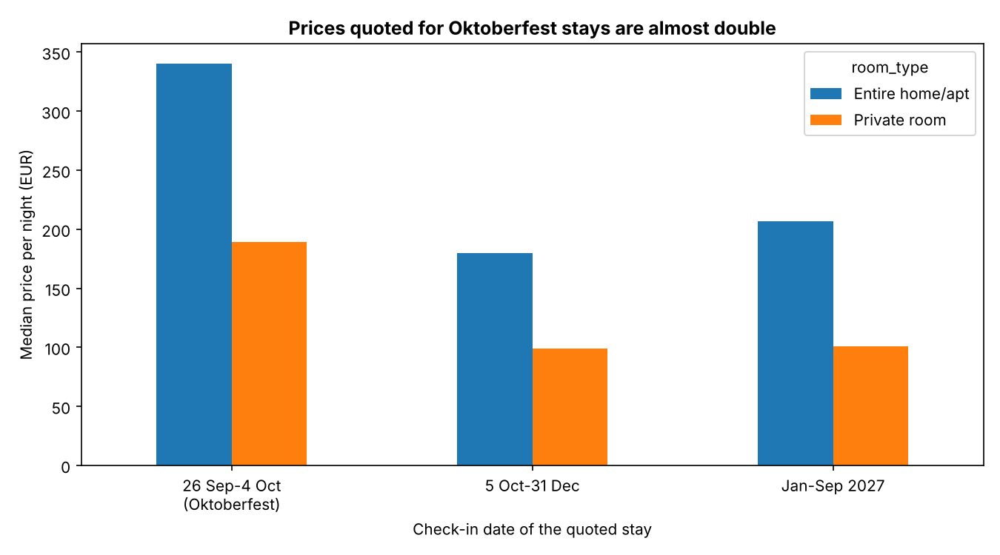
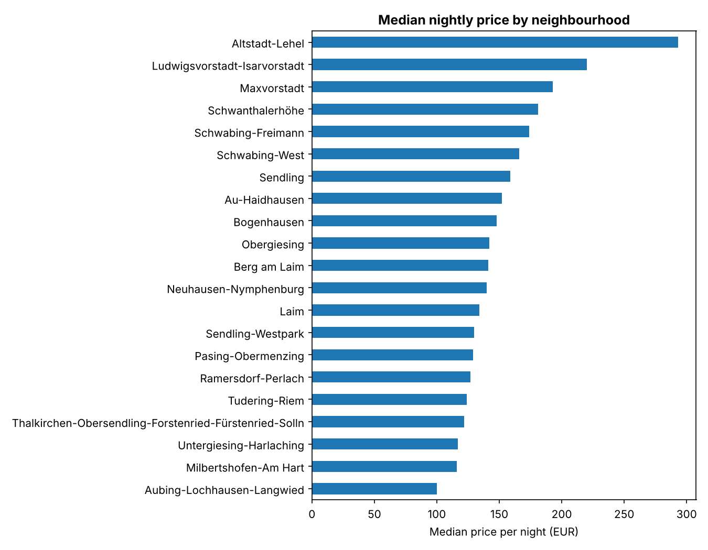

# Munich Airbnb Market: SQL Case Study

A SQL-first analysis of Munich's short-term rental market, built on Inside Airbnb's public data
(listings, calendar and reviews; snapshot of 25-26 September 2026). It asks business questions
about supply, prices, hosts, demand and availability, and treats the data's quirks as part of the
work: 36 queries, cleaned views, data-quality checks, and every number cross-checked against an
independent pandas calculation.

## Key findings

**Supply**
- 7,493 listings: 66.6% entire homes, 32.5% private rooms. Five of 25 districts hold 37.8% of them;
  Ludwigsvorstadt-Isarvorstadt alone has 12.8% (956 listings).
- Only **46.7%** of listings are alive (bookable *and* reviewed in the last 12 months). **28.0%**
  have no available night at all in the next 12 months, and 25.2% are bookable but have had no
  recent review.

**Prices** (like-for-like base: stays of up to 7 nights, check-in from 5 Oct 2026; 2,015 listings)
- Median price per night: **entire home EUR 183** (mean 245), **private room EUR 100** (mean 150),
  city median EUR 154. Means are far above medians because a few listings are very expensive.
- Prices quoted for Oktoberfest dates are almost double: EUR 340 against EUR 180 for entire homes
  and EUR 189 against EUR 99 for private rooms. 57.4% of the short-term price quotes in the file
  fall in that window (see "The price column" below).
- Size drives price: entire homes cost EUR 156 (1 bedroom), 291 (2), 355 (3) and 437 (4+).
- Altstadt-Lehel is the most expensive district at EUR 293 (+90% over the city median).
  Aubing-Lochhausen-Langwied looks cheapest at EUR 100, but **78% of its priced listings belong to
  one host**; in every other district the largest host holds 15% or less.
- Top-rated entire homes (4.9-5.0) have a median of EUR 212 against EUR 153 for 4.5-4.69. That is an
  association: it is not controlled for size or location.

**Hosts**
- 87.1% of hosts have a single listing and hold 66.8% of all listings. The 81 hosts (1.4%) with six
  or more listings hold 842 listings (11.2%); the ten largest hosts hold 3.6%.
- Superhosts (18.8% of listings) got 18.8 reviews per listing in the last 12 months against 4.3 for
  other hosts, at the same median price (EUR 153 against 154). Superhost status requires activity,
  so part of that gap is by definition.



**Demand** (a review follows a stay, so reviews are a proxy for stays)
- Reviews fell from 16,529 in 2019 to 7,899 in 2020 (-52%), then reached 46,635 in 2025. Q2 2020 was
  only 15% of Q2 2019; by Q2 2022 reviews were back at 122%.
- Growth continues: 1 Jan-25 Sep 2026 has 37,596 reviews, **+14.9%** on the same period of 2025.
- September is the busiest review month (13.1% of a year's reviews, averaged over 2022-2025),
  then October (11.5%) and August (10.7%). February is the quietest (3.9%).
- Of today's listings whose first review came in 2017-2022, about half were reviewed in the last
  12 months and 39-46% have no bookable night in the next 12; for the 2025 cohort the figures are
  85% and 18%. (The snapshot only contains listings that exist today, so older cohorts are survivors.)



**The forward calendar** (26 Sep 2026 - 25 Sep 2027; "unavailable" means booked or blocked)
- Among bookable listings, 42% of nights are unavailable in Dec 2026 and Feb-Mar 2027, rising to 58%
  in July 2027. There is almost no weekday effect (48.8% to 50.6%, Saturday highest).
- The tightest week is 28 Sep-4 Oct 2026 at 70% unavailable, the last week of Oktoberfest 2026. It is
  also the nearest week in time, so event and lead-time effects overlap. The second tightest, at
  61% a year ahead, is the week of 13 Sep 2027, which contains Oktoberfest 2027's opening weekend.



## The price column: not what it looks like

`price` in Inside Airbnb's file is the per-night price of a **sample stay quoted for each listing's
earliest available dates**, not a standard rate. Two things follow, and the SQL handles both:

1. **The quote date matters.** The most common check-in is the day after the scrape, in the middle
   of Oktoberfest (19 Sep-4 Oct 2026), so more than half the quotes are event prices.
2. **The stay length matters.** Per-night prices include length-of-stay discounts: the median
   entire-home price is EUR 188 for a 1-night quote and EUR 101 for 8+ nights.

So all pricing queries use the `priced_listings` view: short-term listings, stays of up to
7 nights, check-in from 5 Oct 2026. The first pricing results of this project, before this was
found, were blends of event and non-event prices (entire home EUR 263, private room EUR 150).





## Data quality: what the checks found

| Finding | Handling |
|---|---|
| 32.2% of listings have no price, and **all 2,101 listings with no available night** are among them | Prices describe bookable listings only |
| `price` is a sample-stay quote (see above) | Like-for-like view; diagnostic queries show the effect |
| 2 prices above EUR 68,000 per night | Excluded from price statistics (`price_clean`) |
| 819 review ids appear under more than one listing (1,152 excess rows, 0.46%) | `reviews_dedup` view for market-level counts |
| 35 listings have no minimum stay | Filled from the calendar (it shows 1-6 nights) |
| `availability_365` matches the calendar for 7,458 listings; 35 differ by more than 3 nights (up to 364) | The calendar is the source of truth |
| 241 listings require 30+ nights (mid-term rentals) | Excluded from price statistics |
| `license` is blank for 99.5% of listings; `host_since` and `bathrooms` are empty | Not used |

The first version of the like-for-like view silently treated a missing minimum stay as short-term.
An independent pandas check caught it: SQL had one more listing than pandas in two districts.

## The queries

All queries sit in `sql/`, each starting with `-- name: <result_name>`; `run_queries.py` executes
them and writes `results/<result_name>.csv`.

| File | Question | Queries |
|---|---|---|
| `00_schema.sql`, `01_views.sql` | Tables, indexes and the cleaned views every query builds on | - |
| `02_data_quality.sql` | Can the data be trusted? Orphans, nulls, duplicates, cross-checks | 9 |
| `03_market_overview.sql` | How big is supply, and how much of it is alive? | 5 |
| `04_pricing.sql` | What do listings cost? Quote-date and stay-length effects, districts, size, rating | 7 |
| `05_hosts.sql` | Who runs the supply? Host size, concentration, superhosts | 4 |
| `06_reviews_trends.sql` | How has demand developed? Growth, COVID, seasonality, cohorts | 6 |
| `07_availability.sql` | What does the next year's calendar show? | 5 |

SQL used: CTEs, window functions (`RANK`, `ROW_NUMBER`, `LAG`, `FIRST_VALUE`, running totals,
12-month rolling frames), medians and quartiles built from window functions (SQLite has no
`MEDIAN`), anti-joins, conditional aggregation, `UNION ALL` reports, views for reusable cleaning,
cohort analysis, and cross-checks between independent sources of the same fact.

## Repository structure

```
munich-airbnb-sql-analysis/
├── data/
│   ├── README.md              how to download the data, columns used, what is excluded
│   └── raw/                   (not committed) put the three Inside Airbnb files here
├── python/
│   ├── build_database.py      CSV files -> SQLite database
│   ├── run_queries.py         runs every query, writes results/*.csv
│   ├── verify_with_pandas.py  recomputes 10 key results independently in pandas
│   └── make_charts.py         charts from the result files
├── sql/                       schema, views and the 36 queries
├── results/                   one CSV per query (aggregates only)
└── screenshots/               the charts above
```

## How to run

1. Download the three files as described in `data/README.md` into `data/raw/`.
2. From the `python/` folder:

```bash
pip install pandas matplotlib
python build_database.py       # about 15 seconds, creates data/munich_airbnb.db
python run_queries.py          # writes results/*.csv
python verify_with_pandas.py   # 10 checks: SQL results against pandas on the raw files
python make_charts.py          # writes screenshots/*.png
```

## Limitations

- **One snapshot.** There is no price or booking history, and the calendar looks only forward.
- **Unavailable is not occupied.** The calendar cannot separate booked nights from nights the host
  blocked, so availability figures are an upper bound for bookings. Revenue and occupancy are not
  estimated here, and Inside Airbnb's own modelled estimates are not used.
- **Prices cover bookable listings only** (the file has none for the rest) and are one sample stay
  per listing, so the medians are indicative, not market rates.
- **Reviews are not stays.** Reviews lag stays and only some guests leave one.
- **Survivorship.** Listings that have left the platform are not in the snapshot.
- **The Oktoberfest window is specific to this snapshot** and is set in `01_views.sql` and
  `04_pricing.sql`.

## Data and attribution

Data: [Inside Airbnb](https://insideairbnb.com/get-the-data/), Munich snapshot 25-26 Sep 2026,
licensed CC BY 4.0. Independent analysis, not affiliated with Airbnb or Inside Airbnb. The
repository contains no raw data and no personal data: reviewer names, review text and host names
are never loaded, and `results/` holds aggregates only. Oktoberfest dates from the City of Munich
(muenchen.de).
